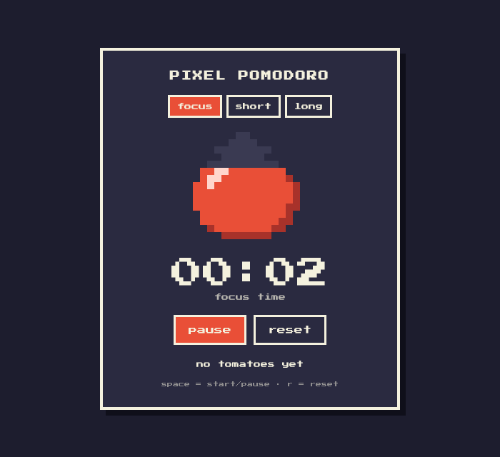

# 🍅 Pixel Pomodoro

A retro, pixel-art Pomodoro timer that runs in the browser. The tomato fills up as you focus, turns into a coffee cup on breaks, and plays a little 8-bit chime when a session ends.

I built it because I kept losing track of time while studying, and I wanted a small project to practise plain JavaScript (no frameworks), ES modules, the Canvas API and the Web Audio API.



## Features

- **25 / 5 / 15 cycle** with a long break after every 4 focus sessions
- **Pixel-art sprites** drawn on a `<canvas>` from tiny text "bitmaps" (see `src/pixels.js`)
- **8-bit chime** generated with the Web Audio API, so there are no sound files
- **Live tab title** so you can see the countdown from another tab
- **Keyboard shortcuts**: `Space` to start or pause, `R` to reset
- **Custom durations** through the URL, for example `index.html?focus=50&short=10&long=20` (minutes)
- **No dependencies and no build step.** Just open it.

## Running it

ES modules need to be served over HTTP (opening the file directly with `file://` will not load them), so start any static server in the project folder:

```bash
git clone https://github.com/blackdalc7/pixel-pomodoro.git
cd pixel-pomodoro
python3 -m http.server 8000      # or: npm start
```

Then open <http://localhost:8000>.

### Hosting it for free

Because it is just static files, it can be published with GitHub Pages: in the repository go to **Settings → Pages**, choose **Deploy from a branch**, pick `main` and `/ (root)`, and it will be live at `https://blackdalc7.github.io/pixel-pomodoro/` after a minute.

## Running the tests

The timer logic is kept separate from the DOM so it can be tested with Node's built-in test runner. Node 18 or newer is enough, and there is nothing to install.

```bash
npm test
```

```
✔ new timer starts in focus mode, paused, with full time
✔ tick counts down while running
✔ finishing focus moves to a short break and counts the tomato
✔ every Nth focus session earns a long break
...
# pass 10
```

## How it works

```
index.html
src/
├── timer.js    pure state machine: createTimer, tick, start, pause, reset, switchMode
├── pixels.js   16x16 sprites as strings + drawSprite() for the canvas
├── app.js      wires the DOM, the update loop, keyboard shortcuts and sound
└── styles.css  the retro look (Press Start 2P font, chunky borders, hard shadows)
tests/
└── timer.test.js
```

**The timer is a tiny state machine.** Every function in `timer.js` takes a state object and returns a new one instead of changing it, which made it really easy to test:

```
focus ──(done)──▶ shortBreak ──(done)──▶ focus ──(done)──▶ ... ──(4th focus done)──▶ longBreak
```

**Time is measured, not counted.** Counting `setInterval(..., 1000)` callbacks drifts, because browsers throttle timers in background tabs. Instead, the loop runs every 200 ms, measures how many real milliseconds passed since the last call with `performance.now()`, and calls `tick(state, elapsedSeconds)`, so the countdown stays accurate.

**Sprites are just strings.** Each row of a sprite is a 16-character string where every character is a colour from a small palette:

```js
"..RRRRRRRRRR....",
".RRWWRRRRRRRR...",   // W = the shiny highlight
```

`drawSprite()` loops over the characters and draws a `scale x scale` square for each one. Rows above the "fill line" are drawn in grey, which is how the tomato fills from the bottom as the session progresses.

## Things I learned

- A bug where pressing *start* did nothing turned out to be `querySelectorAll("[data-mode]")` also matching `<body data-mode="...">`, so every click bubbled up and switched the mode back. Scoping the selector to `nav [data-mode]` fixed it.
- Pure functions plus a thin DOM layer make front-end code much easier to test.
- `image-rendering: pixelated` keeps pixel art crisp when a small canvas is scaled up.

## Ideas for later

- [ ] Save the tomato streak in `localStorage`
- [ ] A settings panel instead of URL parameters
- [ ] Browser notifications when a session ends
- [ ] A small task list attached to each focus session

## License

MIT, see [LICENSE](LICENSE).
